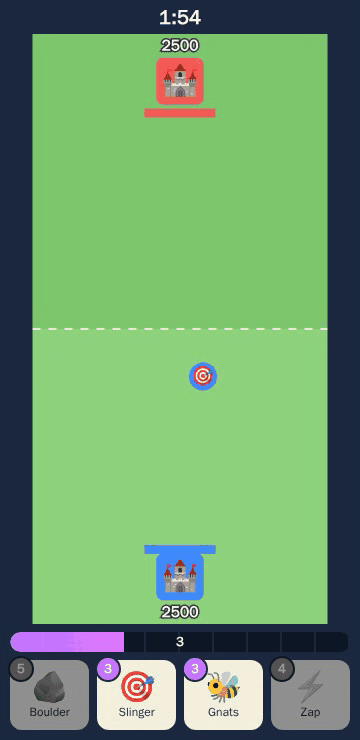

# Lane Clash

A two-minute, one-lane battler you play with one thumb: spend energy, drop units, break the other tower.



[](https://github.com/weblinkify/lane-clash/actions/workflows/ci.yml)
[](https://lane-clash-lilac.vercel.app)

**Play it: https://lane-clash-lilac.vercel.app** (open it on your phone; "Add to Home Screen" installs it and it then works offline).

## How to play

- You are blue, at the bottom. The bot is red, at the top. A match lasts two minutes.
- Your energy bar refills on its own. Tap a card, then tap the field to spend it.
- Units go anywhere in **your half**. The spell can be cast **anywhere**.
- Destroy the red tower to win. At time-out the tower with more health wins; equal health is a draw.

| Card | Cost | What it does |
|---|---|---|
| 🪨 Boulder | 5 | Slow tank with a lot of health. Soaks up damage for the units behind it. |
| 🎯 Slinger | 3 | Fragile, hits from a long way off. |
| 🐝 Gnats | 3 | Four fast, weak units. Shred a lone tank, die to the spell. |
| ⚡ Zap | 4 | Damages every enemy in a circle, and the tower a little if it is in range. |

Units walk at the enemy tower and fight the nearest enemy they can see on the way. Towers do not shoot back, so an attack you ignore will reach your tower.

## Setup

With Docker (nothing else needed):

```sh
docker compose up dev                 # dev server on http://localhost:5173 and http://<your-ip>:5173 for a phone on the same Wi-Fi
docker compose run --rm test          # type check + unit tests with coverage
docker compose run --rm sim           # balance table, 200 bot-vs-bot matches
docker compose up -d --build web      # production build on nginx at http://localhost:8080
docker compose run --rm e2e           # Playwright smoke test against web
docker compose run --rm gif           # re-record docs/gameplay.gif
```

After changing `package.json`, add `--build` (for example `docker compose run --rm --build test`) so the image picks up the new dependencies.

With npm (Node 22):

```sh
npm ci
npm run dev             # dev server
npm run typecheck
npm run test:coverage   # unit tests + coverage for src/sim
npm run sim -- --seed 1 --matches 200
npm run build           # production build in dist/
npm run e2e             # needs the web container (or BASE_URL=...) and `npx playwright install chromium`
```

## Architecture

All the rules live in a pure simulation. It advances in fixed 20 Hz ticks, takes its randomness from a seed, and never touches the DOM, the clock or `Math.random`, so the same seed and the same commands always give the same match. Everything else reads the state and submits commands.

```
  touch ──► input ──┐
                    ├─► commands ──► sim.step(state, commands) ──► state ──► render (canvas)
  state ──► bot ────┘                 20 Hz, seeded, pure            │
                                                                     └────► hud / screens (DOM)
```

| Part | Files | Job |
|---|---|---|
| Simulation | `src/sim/sim.ts`, `rng.ts`, `balance.ts` | State, `step`, command checks, combat, energy, win conditions. All numbers are in `balance.ts`. |
| Bot | `src/sim/bot.ts`, `match.ts` | Reads the state, returns a command like a player would. Easy plays random cards; hard aims the spell, counters attacks and pushes behind a tank. `match.ts` runs bot-vs-bot matches. |
| Render | `src/render/render.ts` | Draws a state on the canvas, interpolating between ticks. Handles device pixel ratio. |
| Input | `src/input/input.ts` | Turns touches into field coordinates; blocks zoom, scroll and pull-to-refresh. |
| UI | `src/ui/hud.ts`, `screens.ts` | Energy bar, timer, cards, menu and result screens, win count in `localStorage`. |
| Loop | `src/main.ts` | Owns the clock: gathers commands, steps the simulation, renders. |

Two rules keep a tick fair to both sides: every unit decides from the same snapshot before any move or damage is applied, and spells resolve before placements. The balance script found a 58/42 side bias before those were in place.

## Changing the balance

1. Edit `src/sim/balance.ts` (unit stats, card costs, energy rate, tower health, match length).
2. Run `npm run sim` (or `docker compose run --rm sim`).
3. Read the table:

```
Lane Clash balance: 200 matches, seed 1, left=hard right=hard

card      cost   played   win rate
--------  ----  -------  ---------
boulder      5     1474      56.0%
slinger      3      722      59.6%
gnats        3     5766      35.5%
zap          4     1374      54.1%

win rate = deployments by the side that won / all deployments of that card

left wins     82   41.0%
right wins   101   50.5%
draws         17    8.5%
average match length  110.0 s
```

A card far above 50% is carrying wins; far below, it is being played by the side that loses. The numbers reflect how the bots use a card as much as the card itself: the hard bot's default defence is Gnats, so the losing side plays a lot of them. For a view with no strategy in it, compare random play with `--left easy --right easy`, where the three units sit at 52–55% and Zap at 32% (thrown at random it is a poor card; aimed, it is a good one). Flags: `--seed`, `--matches`, `--left easy|hard`, `--right easy|hard`. The same flags always print the same table.

## Testing

- **Unit tests (Vitest, simulation only):** `npm run test:coverage`. 109 tests cover damage, targeting, energy, placement, the swarm, win conditions, determinism, the bots and the balance data. Coverage of `src/sim` is 100% of lines.
- **Smoke test (Playwright, phone viewport with touch):** `docker compose run --rm e2e`. Loads the production container, places a card by touch, fast-forwards to the result screen, uses Play Again, checks the win count survives a reload, checks the page does not scroll, and checks the game loads offline.
- **Test hooks:** `?test=1` exposes `window.__laneClash` (`state()`, `fastForward()`); `?test=1&bot=idle` makes the opponent do nothing; `?seed=N` fixes the match seed.

## Deployment

The game is a static site: `npm run build` writes `dist/`.

- **Vercel:** `npx vercel deploy --prod` from the repo root (Vite is detected automatically).
- **Docker:** `docker compose up -d --build web` serves the same build with nginx. The image cannot be built unless the type check, unit tests and build pass inside it.
- **CI:** GitHub Actions runs the type check, unit tests with coverage, the build, the Docker image build and the Playwright smoke test against the container on every push and pull request.

## What was cut

- **Sound and image assets:** by design; everything is shapes and emoji.
- **Towers that shoot:** towers only take damage.
- **Unit collisions:** units can overlap; the rules treat them as points.
- **Attack animations:** a unit swells briefly when it hits and the spell flashes; there are no projectiles.
- **Online play, decks, progression:** one bot, four fixed cards, a win counter.
